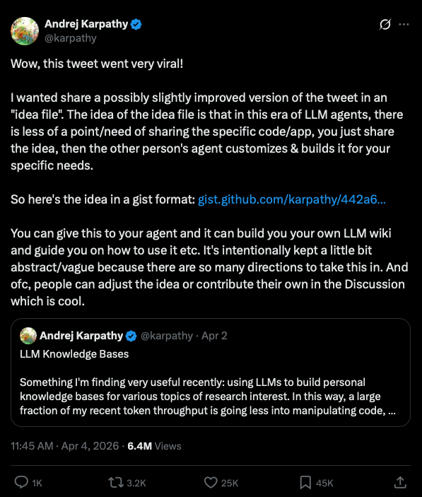
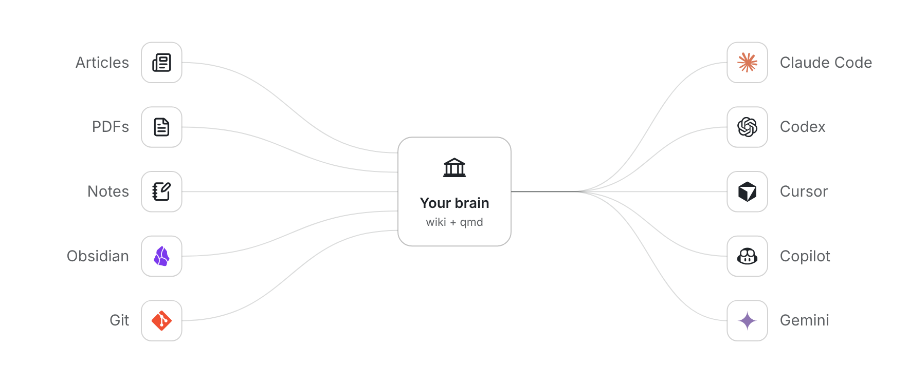

# :classical_building: claude-second-brain

**Your notes don't compound. This wiki does.**

[](https://www.npmjs.com/package/claude-second-brain) [](https://opensource.org/licenses/MIT) [](https://deepwiki.com/jessepinkman9900/claude-second-brain)

[Getting started](https://jessepinkman9900.github.io/claude-second-brain/getting-started) · [Skills](https://jessepinkman9900.github.io/claude-second-brain/skills) · [CLI](https://jessepinkman9900.github.io/claude-second-brain/cli) · [How it works](https://jessepinkman9900.github.io/claude-second-brain/concepts/how-it-works)

Drop in an article, PDF or note. Your AI agent reads it, files it into a cross-linked wiki, and answers questions about it months later with citations.

> **Inspired by [Andrej Karpathy's approach to LLM-powered knowledge management](https://x.com/karpathy/status/2040470801506541998?s=20)**: give an LLM agent an "idea file" and let it build and maintain your knowledge base.

```bash
npx claude-second-brain
```

Needs Node 22+ and an agent that supports [Agent Skills](https://agentskills.io). [Obsidian](https://obsidian.md) is optional.



## What you get

- **A wiki your agent maintains.** Summaries, topic pages, cross-links and contradiction flags, written for you.
- **Local search** across everything, powered by [qmd](https://github.com/tobi/qmd).
- **An [Obsidian](https://jessepinkman9900.github.io/claude-second-brain/integrations/obsidian) vault** with graph view, backlinks and [git sync](https://jessepinkman9900.github.io/claude-second-brain/integrations/obsidian-git) already set up. Read it on your phone through [iCloud](https://jessepinkman9900.github.io/claude-second-brain/integrations/icloud).
- **Plain git** as the source of truth: GitHub, Cloudflare Artifacts, or any remote.

## Quickstart

1. **Create a brain.** Run `npx claude-second-brain` and answer four prompts.
2. **Build the search index.** Run `pnpm qmd:reindex` in the new brain folder. The first run downloads about 2GB of models, once per machine.
3. **Add a source.** Save an article to `raw-sources/articles/` and run `/brain-ingest` in your agent.
4. **Ask.** Run `/brain-search` with a question and get an answer that cites your wiki pages.

The [setup guide](https://jessepinkman9900.github.io/claude-second-brain/getting-started) covers each prompt, git remotes and Obsidian.

## Skills

| Skill | What it does |
|---|---|
| [`/brain-ingest`](https://jessepinkman9900.github.io/claude-second-brain/skills/brain-ingest) | Read a source and fold it into the wiki |
| [`/brain-search`](https://jessepinkman9900.github.io/claude-second-brain/skills/brain-search) | Answer a question with citations |
| [`/lint`](https://jessepinkman9900.github.io/claude-second-brain/skills/lint) | Find broken links, orphans and contradictions |
| [`/brain-refresh`](https://jessepinkman9900.github.io/claude-second-brain/skills/brain-refresh) | Re-index after edits |
| [`/brain-rebuild`](https://jessepinkman9900.github.io/claude-second-brain/skills/brain-rebuild) | Redesign the search index (destructive) |

Works with Claude Code, Codex, Cursor, GitHub Copilot and [11 more agents](https://jessepinkman9900.github.io/claude-second-brain/skills).

## How it works

Your sources go in on the left. Your brain in the middle is a wiki your agent writes and cross-links, with qmd indexing it for search. Any agent on the right can read and grow it, and because the vault is a git repo, Obsidian and every device see the same files.



More in [How it works](https://jessepinkman9900.github.io/claude-second-brain/concepts/how-it-works) and the [wiki schema](https://jessepinkman9900.github.io/claude-second-brain/concepts/schema).

## CLI

```bash
csb ls                            # list your brains
csb use <name>                    # switch the default brain
csb skills --agent codex,cursor   # install skills for more agents
csb doctor                        # check tools, config and skills
```

`csb` comes with `npm i -g claude-second-brain`. Every command is in the [CLI reference](https://jessepinkman9900.github.io/claude-second-brain/cli).

## License

MIT
